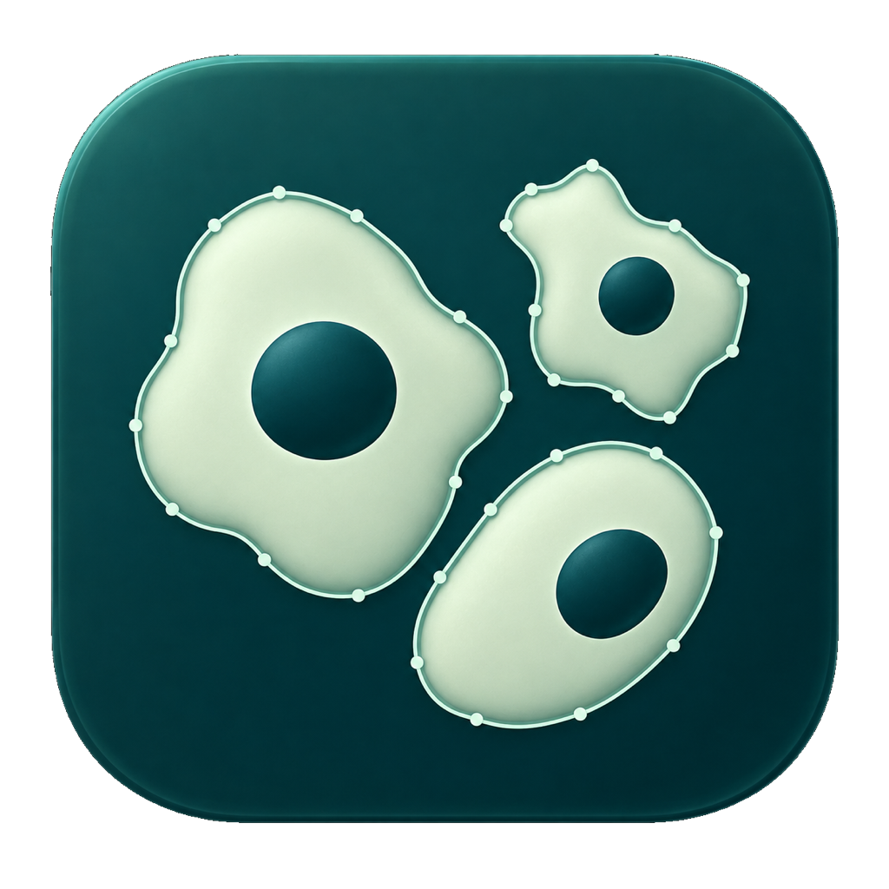

# CellCounter

**A local microscopy workbench for segmentation, measurement and reproducible analysis.**

Import images, review and correct cell masks, quantify experiments, and export results with their analysis history.

[Download](#download) · [Features](#features) · [Comparison](#feature-comparison) · [Quick start](#quick-start) · [AI-agent access](#automation-and-ai-agents) · [Documentation](#documentation)

---

CellCounter brings image analysis, manual correction and experimental results into one project. Use the
desktop app, command line, Python SDK or Model Context Protocol (MCP) to work with the same images,
masks, measurements and history.

Analysis runs on your computer. No account required.

## Download

| Edition | Requirements | Download |
| --- | --- | --- |
| **macOS 1.1.0** | macOS 15 or later; Apple silicon or Intel | [Universal application](https://github.com/Alperen-Gur/CellCounter/releases/tag/v1.1.0) |
| **Windows 1.3.0** | Windows 10 or 11, 64-bit | [EXE and MSI installers](https://github.com/Alperen-Gur/CellCounter/releases/tag/windows-v1.3.0) |
| **Web 0.3.2 preview** | A supported modern browser; served over HTTPS or localhost | [Static PWA package](https://github.com/Alperen-Gur/CellCounter/releases/tag/web-v0.3.2) |
| **Python SDK 0.1.0** | Python 3.11 or later and the required analysis dependencies | [Wheel and source package](https://github.com/Alperen-Gur/CellCounter/releases/tag/v1.1.0) |

Follow the [macOS guide](docs/INSTALL.md) or [Windows guide](docs/WINDOWS.md) for installation and
first-launch help. In the desktop app, choose **Install or repair** to set up the analysis runtime.

The **web preview** runs in your browser and includes classical segmentation, measurements, assays and
portable workspaces. See the [web guide](docs/WEB.md) and [edition comparison](docs/PLATFORM-PARITY.md).

## Features

| Capability | What you can do |
| --- | --- |
| **Segmentation and correction** | Segment cells with classical methods or local AI models. Edit masks with polygon and brush tools, merge or split objects, compare masks and undo corrections. |
| **Measurements and assays** | Measure counts, morphology, size, fluorescence, marker positivity, colocalization, confluence and wound closure. Inspect results alongside the source images. |
| **Multidimensional imaging** | Explore channels, Z planes and time points with linked orthogonal and volume views. Segment 3D objects and review tracks and lineage. |
| **Repeatable workflows** | Save linear or branching analysis workflows, run parameter sweeps, review intermediate results and resume interrupted jobs from saved checkpoints. |
| **Experiments and review** | Organize conditions, plates and biological specimens. Compare model results, review flagged objects and analyze biological replicates. |
| **Traceable results** | Update measurements after corrections and refresh related results. Export images, tables, reports and portable projects with their settings and history. |

Use **Cellpose 3**, **Cellpose 4 / Cellpose-SAM**, **StarDist 2D**,
**Omnipose** and **micro-SAM**. Set up a model environment and select its checkpoint to get started.

Import raster images, TIFF/OME-TIFF acquisitions and regions from OME-NGFF datasets or OMERO servers.

See the [feature guide](docs/FEATURES.md) for more, or follow the [Workbench guide](docs/WORKBENCH.md)
from import to export.

## Feature comparison

CellCounter desktop alongside other open-source microscopy tools. Updated **23 October 2026**.

**✓** included · **Plugin** extension · **?** undocumented

| Feature | **CellCounter** | [Cell-ACDC](https://cell-acdc.readthedocs.io/en/stable/) | [Fiji / ImageJ](https://imagej.net/learn/) | [napari](https://napari.org/stable/) | [CellProfiler](https://cellprofiler.org/) | [QuPath](https://qupath.readthedocs.io/en/stable/) |
| --- | :---: | :---: | :---: | :---: | :---: | :---: |
| Classical segmentation | ✓ | ✓ | ✓ | Plugin | ✓ | ✓ |
| Learned segmentation | Cellpose / StarDist / SAM | ✓ | Plugin | Plugin | Plugin | Plugin |
| Manual mask / object correction | ✓ | ✓ | ✓ | ✓ | ✓ | ROIs / objects |
| Morphology and fluorescence measurements | ✓ | ✓ | ✓ | Plugin | ✓ | ✓ |
| 3D segmentation | Threshold / watershed | ✓ | Plugin | Plugin | Selected modules | ? |
| Object tracking | ✓ | ✓ | TrackMate | Plugin | TrackObjects | ? |
| Lineage / division annotation | Division review | ✓ | TrackMate | Plugin | TrackObjects | ? |
| Large, multiscale image viewing | TIFF / NGFF regions | ? | BigDataViewer | ✓ | ? | ✓ |
| Reusable analysis | Workflows | Saved recipes | Macros / scripts | Plugins / scripts | Pipelines | Scripts |
| Batch analysis | ✓ | ✓ | ✓ | Scripts / plugins | ✓ | ✓ |
| Script / API access | CLI / Python SDK | CLI / Python interfaces | Macros / APIs | Python API | CLI / Python modules | Groovy / CLI |
| MCP tools for AI agents | ✓ | ? | Plugin | Plugin | ? | ? |

See the [full comparison](docs/COMPARISON.md) for commercial alternatives and links to each project's documentation.

## Quick start

1. **Set up.** Install the desktop app, open **Workbench**, and install or repair its dedicated runtime.
2. **Import.** Create a local project, add images, and confirm the source channel, projection and spatial calibration.
3. **Analyze.** Preview segmentation on a representative image, adjust settings, then save the masks and measurements.
4. **Review.** Correct masks, review flagged objects and run assays. Group images by specimen and condition to compare experiments.
5. **Export.** Save a reusable workflow, export labels and measurement tables, or create a portable analysis package with source data, settings and history.

You can also copy an existing image library into a Workbench project with the migration tools.
Start with the [desktop walkthrough](docs/WORKBENCH.md#desktop-workflow).

## Automation and AI agents

Run the same analysis from the app, a script or an AI agent.

| Interface | Use |
| --- | --- |
| **Desktop GUI** | Set up analyses, inspect images, correct masks and review results interactively. |
| **Command line** | Run analysis commands from scripts and receive JSON results. |
| **Python SDK** | Open projects and run analyses with `WorkbenchClient`. |
| **MCP server** | Connect an AI agent to inspect projects, run analyses, correct masks and export results. |

Open **AI agent and command-line access** in the desktop app to prepare connection settings.
Choose which projects and folders the agent can access and whether it can make changes.

Follow the [CLI examples](docs/WORKBENCH.md#cli-example), [Python SDK guide](docs/WORKBENCH.md#python-sdk)
or [MCP connection guide](docs/WORKBENCH.md#mcp-connection).

## Local data and reproducibility

Your images stay on your computer or in your browser. Connect your own OMERO server to import remote data.

Export an analysis package to keep source images, masks, workflows, settings and history together.
Use these packages to share an analysis or return to it later.

## Documentation

| Guide | Contents |
| --- | --- |
| [Installation](docs/INSTALL.md) | macOS setup, runtime installation and first-launch help |
| [Windows](docs/WINDOWS.md) · [Web preview](docs/WEB.md) | Platform-specific installation, workflows and troubleshooting |
| [Features](docs/FEATURES.md) · [Platform comparison](docs/PLATFORM-PARITY.md) | Supported capabilities and edition differences |
| [Software comparison](docs/COMPARISON.md) | Open-source and commercial tools, with links to their documentation |
| [Workbench](docs/WORKBENCH.md) | Analysis, correction, workflows, experiments, export, CLI, SDK and MCP |
| [Portable workspace](docs/PORTABLE-WORKSPACE.md) | Browser workspace formats, layers and editing tools |
| [Releases](https://github.com/Alperen-Gur/CellCounter/releases) | Downloads, checksums and version history |
| [Contributing](CONTRIBUTING.md) | Building from source, reporting bugs and contributing changes |

## Support and citation

Report problems or request features in [GitHub Issues](https://github.com/Alperen-Gur/CellCounter/issues).
Include your application version, operating system, relevant settings and steps to reproduce the problem.
Share only image data or logs you are permitted to disclose.

If you use CellCounter in research, cite the software using [CITATION.cff](CITATION.cff) and cite the segmentation
models and methods used in your analysis. Record the application and model versions in your methods.

CellCounter builds on open-source scientific software, including [Cellpose](https://github.com/MouseLand/cellpose),
[StarDist](https://github.com/stardist/stardist) and [Omnipose](https://github.com/kevinjohncutler/omnipose).
See [third-party acknowledgments and licenses](THIRD_PARTY_LICENSES.md).

## License

CellCounter source code is available under the [MIT License](LICENSE). Optional dependencies and model weights
retain their respective licenses.
